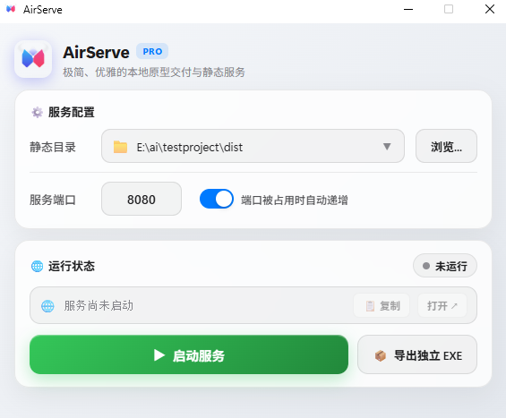
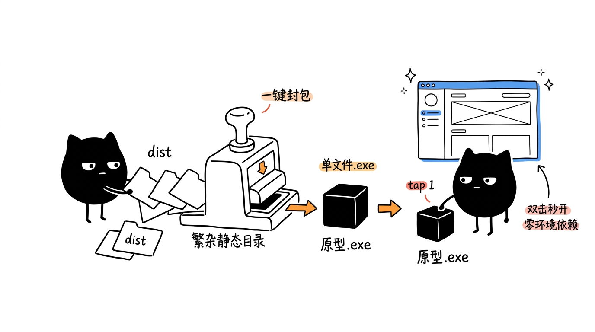

<div align="center">

  

  # AirServe

  **轻量本地静态 Web 服务器，支持一键导出单文件便携 EXE**
  
  *免配置即开即用 · 自动避让可用端口 · SPA 路由支持 · 单文件免安装交付*

  <p align="center">
    <a href="https://github.com/Bing-b/AirServerApp/releases"></a>
    <a href="https://github.com/svenstaro/miniserve"></a>
    <a href="https://pywebview.flowrl.com/"></a>
    <a href="https://www.python.org/"></a>
    <a href="LICENSE"></a>
  </p>

</div>

---

## 应用预览

<div align="center">
  
</div>

---

## 为什么需要 AirServe？

在日常开发、原型演示或给客户交付前端页面时，常常遇到这些麻烦：

- **客户电脑缺少环境**：非技术人员或客户电脑通常没有 Node.js、Python 或 Nginx，无法直接启动本地服务。
- **浏览器直接打开报错**：直接双击 `index.html` 受限于浏览器安全策略，容易触发跨域（CORS）报错或 SPA 路由 404。
- **散装文件传输繁琐**：打包成 zip 发送，对方容易漏解压、找不到入口文件或解压路径错乱。
- **命令行起服务体验不便**：终端工具容易遭遇端口占用冲突，且关闭窗口后后台进程容易残留。

**AirServe 兼具两种使用场景**：
1. **日常自用**：拖入静态网页目录，自动寻找可用端口，一键拉起 Web 服务；
2. **对外交付**：一键将整个前端项目打包为单文件 `.exe`，发给客户直接双击就能看，无需安装任何软件。

---

## 核心特性

| 功能特性 | 说明 |
| :--- | :--- |
| **开箱即用静态服务** | 选择或拖入包含 `index.html` 的目录，秒级启动本地 HTTP 服务。 |
| **一键导出单文件 EXE** | 将整个静态项目封包成一个独立的 `.exe`。接收方双击直接运行并自动弹出浏览器，无任何外部依赖。 |
| **自动避让可用端口** | 自由指定端口；若遇端口占用，自动递增寻找可用端口，避免启动冲突报错。 |
| **SPA 单页应用原生支持** | 默认启用单页应用路由回退 (`--spa`) 与防缓存请求头，完美适配 Vue Router / React Router。 |
| **轻量高效，非 Electron** | 服务内核基于 Rust 构建的 [Miniserve](https://github.com/svenstaro/miniserve)，界面调用系统原生 WebView，拒绝臃肿体积与高内存占用。 |
| **入口文件智能定位** | 误选项目根目录时，自动探测并定位 `dist/` 或 `build/` 子目录下的 `index.html`。 |
| **历史目录记忆与管理** | 自动记录常用目录，支持快捷切换选择与历史记录单独清理。 |
| **干净退出无后台残留** | 退出窗口时自动递归销毁关联子进程，不占用后台端口和系统资源。 |

---

## 典型场景：原型交付工作流

<div align="center">
  
</div>

1. **选择目录**：选择包含前端构建产物（如 `dist/`）的文件夹；
2. **一键导出**：点击 **“导出独立 EXE”**，生成一个便携单文件；
3. **分发演示**：将单个 `.exe` 发送给客户或领导，对方双击即可体验，关闭窗口即停止，干净省心。

---

## 获取与运行

### 方式一：直接下载运行（推荐，免安装）

直接前往 [Releases 页面](https://github.com/Bing-b/AirServerApp/releases) 下载最新发行版：
- **Windows**：下载 `AirServe.exe`，免安装直接运行。
- **macOS**：下载 `AirServe.app`。

---

### 方式二：从源码运行（开发者）

如果你想进行二次开发或本地调试：

1. **克隆代码**：
   ```bash
   git clone https://github.com/Bing-b/AirServerApp.git
   cd AirServerApp
   ```

2. **安装 Python 依赖**：
   ```bash
   pip install -r requirements.txt
   ```

3. **启动应用**：
   ```bash
   python main.py
   ```

---

## 本地构建打包

项目内置了针对 Windows 与 macOS 的一键全量打包脚本：

### Windows (.exe)
```cmd
build_win.bat
```
构建产物位于 `dist/AirServe.exe`，免安装直接运行。

### macOS (.app)
```bash
chmod +x build_mac.sh && ./build_mac.sh
```
构建产物位于 `dist/AirServe.app`。

---

## 开源许可证

本项目基于 [MIT License](LICENSE) 开源发布。
